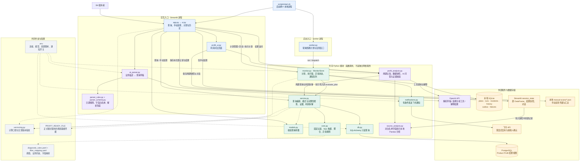
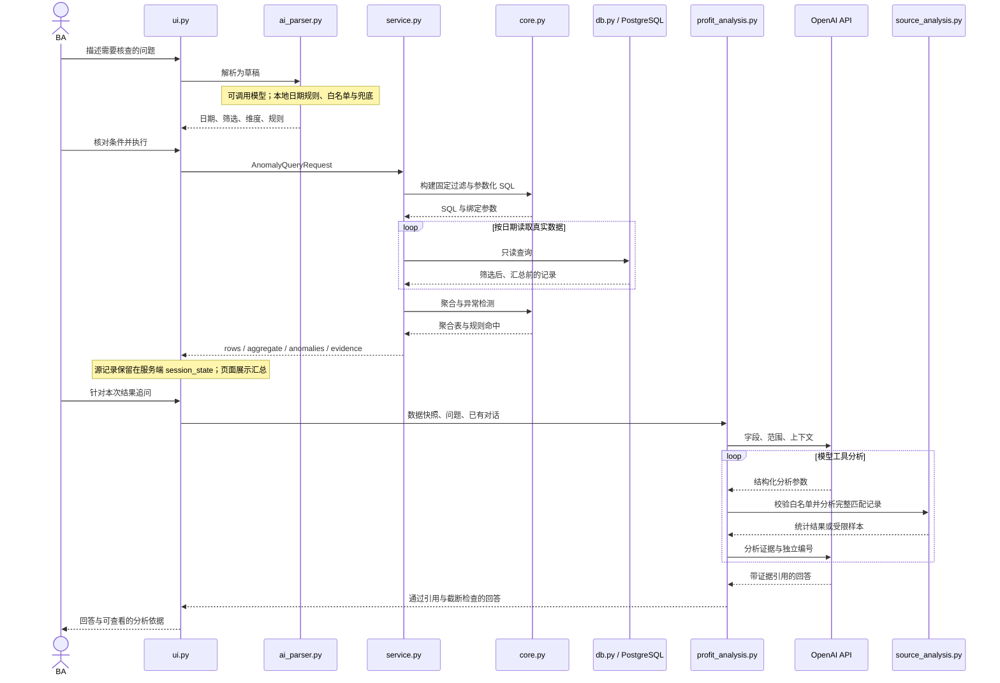

# Product Profit 当前代码模块与关系

Product Profit 是面向 BA 的数据巡查与异常排查工作台。当前实现采用 Python 与 Streamlit：一个交互页面进程和一个后台巡查进程，复用查询、计算与规则代码，连接只读业务视图，并在本地保存巡查状态。

代码基线为 `de1b949`，核对日期为 2026-10-06。以下为现有实现，不是未来重构方案。模块框表示职责边界，不代表独立部署的微服务；共享模块在调用它的进程中执行。

## 文件之间的关系

每个 Python 文件的真实 import 依赖、回调和关键函数关系见 [文件依赖与调用关系](file-dependencies.md)。

## 代码组织结构

目录树与按职责分组见 [代码组织结构](code-structure.md)。其中列出实际文件位置，不代表新的重构目录。

## 模块关系

实线表示主要调用、读写或输入流向；虚线表示配置和约束依赖。图省略普通函数返回箭头及部分重复 import。`monitor.py` 通过传入的评估回调调用业务服务，不是 HTTP 调用。

## 模块职责和代码位置

| 模块 | 代码 | 职责 | 主要关系 |
| --- | --- | --- | --- |
| 启动入口 | [app.py](../../app.py)；[scripts/start.sh](../../scripts/start.sh) | 启动 Streamlit 与独立 worker；包内 app.py 是兼容入口。 | ui.main；worker.main |
| 主界面 | [bi_check_agent/ui.py](../../bi_check_agent/ui.py) | 工作区路由、筛选、查询、手动巡查、异常历史、计划管理、单期结果问答。 | ai_parser、models、service、MonitorStore、profit_ui、profit_analysis |
| 利润界面 | [bi_check_agent/profit_ui.py](../../bi_check_agent/profit_ui.py) | 管理两期条件、进度、结果展示、变化百分比与追问。 | profit_analysis；复用 ui 传入的筛选、下载和错误函数 |
| 业务问题解析 | [bi_check_agent/ai_parser.py](../../bi_check_agent/ai_parser.py) | 调用模型生成结构化草稿，合并本地规则校正；失败时兜底。 | OpenAI API、parser_rules、parser_schema |
| 本地解析规则 | [bi_check_agent/parser_rules.py](../../bi_check_agent/parser_rules.py)；[bi_check_agent/parser_schema.py](../../bi_check_agent/parser_schema.py) | 相对日期、规则别名、筛选提取、结果清洗和字段白名单。 | Python 本地计算；不查询数据库 |
| 查询契约 | [bi_check_agent/models.py](../../bi_check_agent/models.py) | AnomalyQueryRequest 校验日期、维度非空和允许的异常规则。 | 被界面、服务、SQL 构建、利润分析复用 |
| 共享业务服务 | [bi_check_agent/service.py](../../bi_check_agent/service.py) | 三种模式、逐日读取、资源上限、就绪检查、结果证据、计划评估、利润拆解与选项加载。 | core、db、models、versioning |
| 计算与规则 | [bi_check_agent/core.py](../../bi_check_agent/core.py) | 参数化 SQL、固定 main_ir 排除、字段转换、日期维度、汇总及 17 条异常规则。 | models、YAML 配置、Pandas；不自行连接数据库 |
| 数据访问 | [bi_check_agent/db.py](../../bi_check_agent/db.py) | SQLAlchemy 连接 PostgreSQL，在只读事务内查询，设置超时和会话时区。 | DATABASE_URL；Product Profit 结果视图 |
| 比较与 AI 编排 | [bi_check_agent/profit_analysis.py](../../bi_check_agent/profit_analysis.py) | 两期查询与对账、单期或两期快照、模型工具循环、证据编号、引用与截断校验。 | service、source_analysis、OpenAI API |
| 受限源记录分析 | [bi_check_agent/source_analysis.py](../../bi_check_agent/source_analysis.py) | Pydantic 校验分析参数；用 Pandas 执行筛选、统计、分组比较与受限抽样。 | 快照内 DataFrame；不执行模型生成的 SQL 或 Python |
| 巡查状态与执行 | [bi_check_agent/monitor.py](../../bi_check_agent/monitor.py) | MonitorStore 管理计划、运行锁与续租、异常去重与恢复、历史和通知队列。 | SQLite、传入的 evaluate_plan 回调、versioning、notifications |
| 后台调度 | [bi_check_agent/worker.py](../../bi_check_agent/worker.py) | 默认每 30 秒检查到期窗口，执行计划并尝试分发通知。 | MonitorStore；service.evaluate_plan |
| 通知适配 | [bi_check_agent/notifications.py](../../bi_check_agent/notifications.py) | 凭据、接收人、正式模式和影子模式等条件满足时发送飞书；处理送达不明。 | 飞书 HTTP API；不负责计算异常 |
| 口径版本 | [bi_check_agent/versioning.py](../../bi_check_agent/versioning.py) | 对规则 YAML、字段映射和 core/service/db 实现计算哈希。 | 供查询证据、巡查范围标识和页面旧结果失效使用 |
| 配置与测试 | `config/*.yaml`；[.env.example](../../.env.example)；`tests/` | 阈值与字段映射、配置模板、现有行为的回归测试。 | 真实 .env 和 .runtime 不随代码发布 |

## 查询和 AI 问答时序

查询与手动巡查复用 `service.query()`。利润对比则由 `profit_analysis.compare()` 对前后两个时期分别调用同一服务，再用 `service.decompose()` 计算贡献和对账。继续提问复用已读取的快照，不另行连接数据库扩大范围。

## 巡查和存储

后台路径为 `worker.tick → MonitorStore.due_windows/run → service.evaluate_plan → service.query`。运行完成后，MonitorStore 在 SQLite 中更新异常与通知队列；`dispatch()` 再调用通知适配器。页面中的“执行计划检查”也使用这条状态更新路径。

页面的“立即巡查”调用 `service.query()`，把凭据与异常汇总保存为独立 JSON；它不会写入正式异常生命周期，也不会发送通知。两种执行路径共享检查引擎，但保存结果的用途不同。

| 存储 | 保存内容 | 谁读写 | 保留边界 |
| --- | --- | --- | --- |
| PostgreSQL 结果视图 | 业务源记录，混合 order 和 ad_daily | db.py 只读 | 工具不修改业务数据，不接管上游刷新 |
| Streamlit session_state | 查询源 DataFrame、单期/两期快照、对话 | ui.py、profit_ui.py | 服务端会话内存；不是持久化历史库 |
| `.runtime/monitor.sqlite3` 或 PROFIT_STATE_DB | plans、runs、incidents、history、outbox、failures | MonitorStore | 本地持久化；运行与异常凭据可能含受限样本，不是完整源数据仓库 |
| `.runtime/manual-scans/*.json` | 手动巡查凭据、规则汇总 | ui.manual_scan | 默认位于状态库旁；不保存完整源 DataFrame 或对话 |
| PROFIT_READY_FILE | 刷新状态、快照标识、覆盖日期、币种与时区 | service 读取；外部刷新流程提供 | 工具校验凭据，不生成上游已刷新这一事实 |

## AI 与数据边界

AI 有两个调用入口。`ai_parser` 把用户描述转换为待核对的查询草稿；它不生成 SQL。`profit_analysis.answer` 根据已读取的数据回答追问，模型提供结构化分析参数，本地 `source_analysis` 执行计算，然后把统计结果或受限样本返回给模型组织回答。完整 DataFrame 留在本地；选定的统计结果和样本会进入模型上下文，不能表述为数据完全不出本机。

源记录来自 `bi.ba_mv_profit_order_line_and_ad_info`，查询中已经执行固定排除和字段转换。页面展示按维度汇总的结果，AI 分析的是该查询返回的汇总前记录，不能据此声称已验证上游订单、成本或物流系统的根因。

## 三种运行模式

| 模式 | 数据路径 | 用途与限制 |
| --- | --- | --- |
| demo | service.demo_rows 生成合成样本 | 演示查询与巡查，不读真实业务库，不发送飞书 |
| live_test | db.py 只读真实视图 | 交互核查；不作为正式异常恢复依据，不用于定时计划 |
| live | db.py 只读真实视图，并校验刷新就绪凭据 | 可用于正式计划；规则确认、通知开关、影子模式与接收人等仍有独立检查 |

图中存在后台调度和通知模块，表示代码支持这些能力，不表示当前机器已完成真实巡查与通知配置。

## 工程结构判断

`service.py` 是共享业务入口，`core.py` 是计算与规则中心。页面和后台使用同一套引擎，这是保持口径一致的关键。当前 `ui.py` 同时承担页面、部分业务编排和手动记录持久化；`profit_analysis.py` 同时承担比较与问答；`monitor.py` 同时承担状态存储、生命周期和执行协调。它们是现有实现的职责组合，不应画成已经完全独立的服务层。

`app.py` 和 `bi_check_agent/app.py` 都只转入 `ui.main()`，后者是兼容入口，不是第二套产品。`tests/` 是开发验证模块，不进入正常业务数据流。
