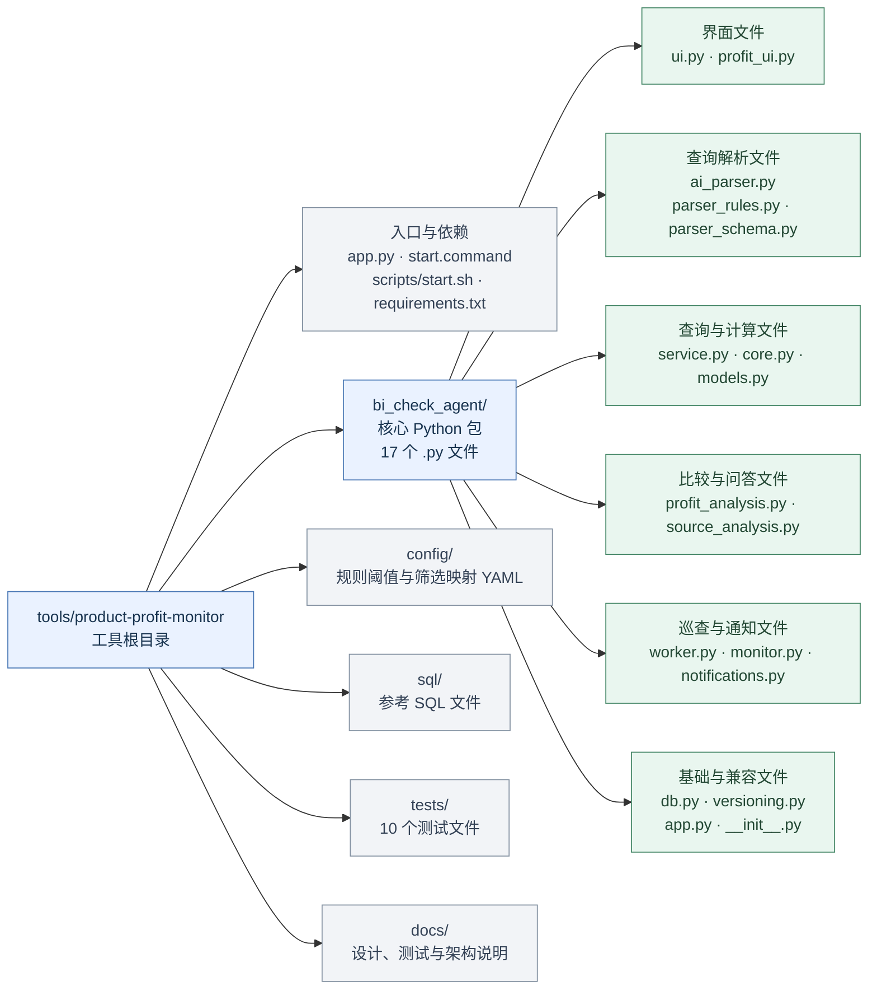

# Product Profit 代码组织结构

代码基线 de1b949，核对日期 2026-10-06。核心代码是一个扁平的 Python 包 bi_check_agent，包含 17 个 Python 文件，共约 2650 行，含注释与空行，不含根入口、测试和配置。界面由 Python Streamlit 编写，当前没有独立的 React 前端目录或 REST API 后端目录。

## 实际目录

```text
codex/                                     GitHub 仓库
└── tools/
    └── product-profit-monitor/            当前工具
        ├── app.py                         主入口，调用 ui.main()
        ├── start.command                  Mac 启动入口
        ├── requirements.txt               Python 依赖
        ├── README.md                      使用说明
        ├── .env.example                   环境配置模板
        ├── scripts/
        │   └── start.sh                   启动页面和巡查进程
        ├── bi_check_agent/                核心代码包
        │   ├── __init__.py                包版本声明
        │   ├── app.py                     兼容旧命令的入口
        │   ├── ui.py                      主页面、筛选和操作编排
        │   ├── profit_ui.py               利润对比页面
        │   ├── ai_parser.py               模型解析业务问题
        │   ├── parser_rules.py            本地日期与关键词解析
        │   ├── parser_schema.py           解析字段、别名和结果清洗
        │   ├── models.py                  查询参数模型及校验
        │   ├── service.py                 共享业务服务
        │   ├── core.py                    SQL 构建、聚合及异常规则
        │   ├── db.py                      只读数据库访问
        │   ├── profit_analysis.py         两期比较及 AI 问答编排
        │   ├── source_analysis.py         受限源记录统计工具
        │   ├── worker.py                  后台调度入口
        │   ├── monitor.py                 巡查执行与状态存储
        │   ├── notifications.py           飞书通知适配
        │   └── versioning.py              计算与规则版本指纹
        ├── config/
        │   ├── diagnostic_rules.yaml      异常阈值和规则说明
        │   └── filter_mapping.yaml        筛选条件与数据库字段映射
        ├── sql/
        │   └── order_line_profit_check_v1.sql  参考 SQL
        ├── tests/                         10 个测试文件
        └── docs/                          设计、联调、验证和架构说明
```

本地还会使用 `.env`、`.venv/` 和 `.runtime/`，分别保存实际配置、Python 环境和运行记录；它们不属于提交到 GitHub 的业务源码。运行查询由 core.py 构建 SQL，当前入口不直接执行 sql/ 中的参考文件。

## 按职责看代码结构

下图是代码包含关系，不是执行顺序。bi_check_agent 下的职责分组只是阅读分组，实际文件仍平铺在同一个目录中。



## 修改时从哪里进入

| 修改内容 | 首先查看的文件 | 需要一起核对 |
| --- | --- | --- |
| 页面文字、筛选与结果展示 | ui.py、profit_ui.py | 页面回归测试及会话状态 |
| 自然语言识别 | ai_parser.py、parser_rules.py、parser_schema.py | models.py 的允许字段和规则 |
| 查询字段、汇总与异常规则 | core.py、service.py、config/ | models.py、parser_schema.py 及源数据分析白名单 |
| 利润对比与问答分析 | profit_analysis.py、source_analysis.py | 输入快照、计算口径与回答证据 |
| 定时执行、异常状态与通知 | worker.py、monitor.py、notifications.py | SQLite 状态与通知启用条件 |
| 数据库连接与只读查询 | db.py | .env 配置及 service.py 完整性检查 |

当前是按文件职责划分的单包结构，没有建立独立的页面层、业务层、数据层子目录。ui.py、service.py、monitor.py 均承担多项职责，规则白名单也存在于多个文件中；因此文件之间已有分工，但尚不是严格分层或独立插件架构。
