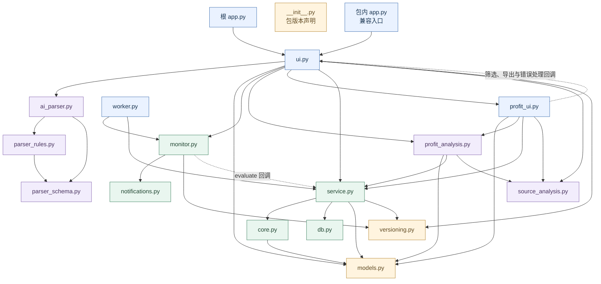

# Product Profit 文件依赖与调用关系

代码基线 de1b949，核对日期 2026-10-06。图中的每个节点对应一个实际 Python 文件，箭头 A → B 表示 A 导入并依赖 B；它不是目录的包含关系，也不是每条路径必定执行的顺序。图包含函数内部的延迟导入，省略第三方库和 Python 标准库。

虚线表示从外部传入函数后发生的回调调用，不能只靠 import 判断。根 app.py 和包内 app.py 是两个不同文件；__init__.py 只有包版本声明，没有直接导入其他内部模块。

## 完整文件依赖图

## 关键调用与返回内容

| 调用者 | 被调用代码 | 具体关系 |
| --- | --- | --- |
| 根 app.py、包内 app.py | ui.main() | 两个入口都进入同一套界面 |
| ui.queries() | ai_parser.parse_business_description() | 把业务描述转成查询草稿 |
| ai_parser | parser_rules、parser_schema | 解析日期、校正规则、清洗字段；模型失败时使用本地兜底 |
| ui.queries()、ui.manual_scan() | service.query() | 传入已校验参数，返回源记录、聚合表、异常与证据 |
| ui.main() | profit_ui.render() | 进入利润页面，并传入筛选、CSV 下载和错误展示函数 |
| profit_ui.render() | profit_analysis.compare()、answer() | 执行比较，或对比较结果继续提问 |
| ui.scan_questions() | profit_analysis.answer() | 对查询或手动巡查的源记录快照继续提问 |
| profit_analysis.compare() | service.query()、decompose() | 查询两个时期，再计算利润差异与贡献 |
| service.query() | core.build_order_line_sql() | 生成 SQL、绑定参数与筛选记录 |
| service.query() | db.run_query() | 执行只读查询并取得 DataFrame |
| service.query() | core.detect_anomalies()、aggregate_product() | 对返回记录执行规则判断与聚合 |
| profit_analysis.answer() | source_analysis.analyze() | 将模型提出的受限参数交给本地统计工具执行 |
| worker.tick() | MonitorStore.due_windows()、run()、dispatch() | 选择到期窗口，执行巡查，再分发通知 |
| worker.tick()、ui 中的计划执行 | service.evaluate_plan | 将这个函数作为 evaluate 参数传给 MonitorStore.run |
| MonitorStore.run() | evaluate(plan, start, end) | 回调 service.evaluate_plan；monitor.py 不直接 import service.py |
| MonitorStore.dispatch() | FeishuSender.send() | 调用通知适配器并记录送达结果 |
| ui、profit_ui、profit_analysis | source_analysis.public_evidence() 等 | 清理给页面展示的证据，避免暴露完整源记录或逐行样本 |

## 共享文件的依赖者

models.py 定义统一查询契约，被 ui、profit_ui、profit_analysis、service、core 引用。versioning.py 被 ui、service、monitor 引用，分别用于旧会话失效、查询证据和巡查范围版本。profit_ui 还直接使用 service.amount_change_percent() 计算展示百分比。

core.py 不调用 db.py：service.py 分别调用 core 构建 SQL、调用 db 读取数据，再把返回记录交给 core 计算。这体现了业务编排和计算代码的实际关系。

profit_ui 不导入 ui.py，但会调用 ui 传入的 business_filters、csv、error 函数。这样的反向回调是当前代码关系的一部分；它不构成 Python import 循环。

## 直接依赖索引

以下索引由 Python AST 提取，行号是当前调用文件中的导入位置。没有内部导入不代表文件无作用，它可能依赖第三方库、配置、数据库，或被其他文件调用。

| 文件 | 直接导入的内部文件及行号 |
| --- | --- |
| [app.py](../../app.py) | [ui.py](../../bi_check_agent/ui.py)（行 1） |
| [bi_check_agent/__init__.py](../../bi_check_agent/__init__.py) | 无内部模块导入 |
| [bi_check_agent/ai_parser.py](../../bi_check_agent/ai_parser.py) | [parser_rules.py](../../bi_check_agent/parser_rules.py)（行 8）；[parser_schema.py](../../bi_check_agent/parser_schema.py)（行 9） |
| [bi_check_agent/app.py](../../bi_check_agent/app.py) | [ui.py](../../bi_check_agent/ui.py)（行 2） |
| [bi_check_agent/core.py](../../bi_check_agent/core.py) | [models.py](../../bi_check_agent/models.py)（行 10） |
| [bi_check_agent/db.py](../../bi_check_agent/db.py) | 无内部模块导入 |
| [bi_check_agent/models.py](../../bi_check_agent/models.py) | 无内部模块导入 |
| [bi_check_agent/monitor.py](../../bi_check_agent/monitor.py) | [notifications.py](../../bi_check_agent/notifications.py)（行 257）；[versioning.py](../../bi_check_agent/versioning.py)（行 25） |
| [bi_check_agent/notifications.py](../../bi_check_agent/notifications.py) | 无内部模块导入 |
| [bi_check_agent/parser_rules.py](../../bi_check_agent/parser_rules.py) | [parser_schema.py](../../bi_check_agent/parser_schema.py)（行 8） |
| [bi_check_agent/parser_schema.py](../../bi_check_agent/parser_schema.py) | 无内部模块导入 |
| [bi_check_agent/profit_analysis.py](../../bi_check_agent/profit_analysis.py) | [models.py](../../bi_check_agent/models.py)（行 11）；[service.py](../../bi_check_agent/service.py)（行 10）；[source_analysis.py](../../bi_check_agent/source_analysis.py)（行 12） |
| [bi_check_agent/profit_ui.py](../../bi_check_agent/profit_ui.py) | [models.py](../../bi_check_agent/models.py)（行 10）；[profit_analysis.py](../../bi_check_agent/profit_analysis.py)（行 11）；[service.py](../../bi_check_agent/service.py)（行 12）；[source_analysis.py](../../bi_check_agent/source_analysis.py)（行 13） |
| [bi_check_agent/service.py](../../bi_check_agent/service.py) | [core.py](../../bi_check_agent/core.py)（行 12）；[db.py](../../bi_check_agent/db.py)（行 12）；[models.py](../../bi_check_agent/models.py)（行 13）；[versioning.py](../../bi_check_agent/versioning.py)（行 14） |
| [bi_check_agent/source_analysis.py](../../bi_check_agent/source_analysis.py) | 无内部模块导入 |
| [bi_check_agent/ui.py](../../bi_check_agent/ui.py) | [ai_parser.py](../../bi_check_agent/ai_parser.py)（行 12）；[models.py](../../bi_check_agent/models.py)（行 13）；[monitor.py](../../bi_check_agent/monitor.py)（行 14）；[profit_analysis.py](../../bi_check_agent/profit_analysis.py)（行 68, 90, 277）；[profit_ui.py](../../bi_check_agent/profit_ui.py)（行 405）；[service.py](../../bi_check_agent/service.py)（行 1, 15）；[source_analysis.py](../../bi_check_agent/source_analysis.py)（行 91）；[versioning.py](../../bi_check_agent/versioning.py)（行 365） |
| [bi_check_agent/versioning.py](../../bi_check_agent/versioning.py) | 无内部模块导入 |
| [bi_check_agent/worker.py](../../bi_check_agent/worker.py) | [monitor.py](../../bi_check_agent/monitor.py)（行 6）；[service.py](../../bi_check_agent/service.py)（行 11） |

## 关系图的阅读方式

顺着 ui.py → service.py → core.py/db.py 可以理解查询实现；顺着 ui.py/profit_ui.py → profit_analysis.py → source_analysis.py 可以理解问答分析；顺着 worker.py → monitor.py ⇢ service.py 可以理解后台巡查如何复用相同业务代码。models.py 和 versioning.py 是被多处依赖的公共模块。

实际依赖并非严格的单向分层：界面会直接引用业务模型、数据服务和证据处理函数，利润页面复用主界面的回调。这张图保留现有依赖，不把它改画成尚未实施的分层架构。
